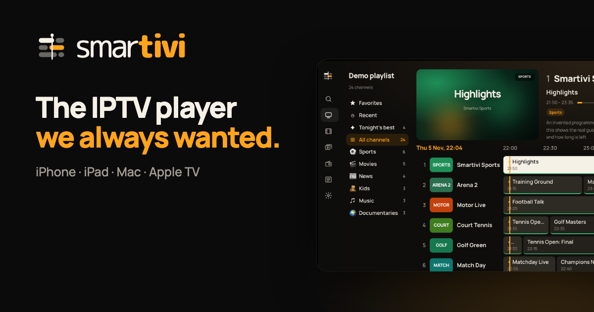
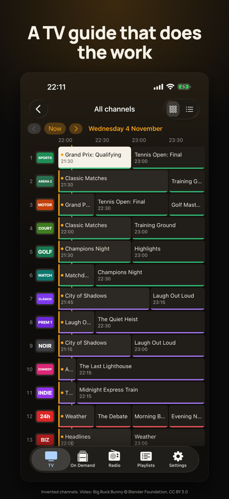
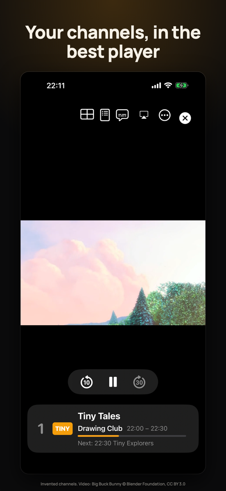
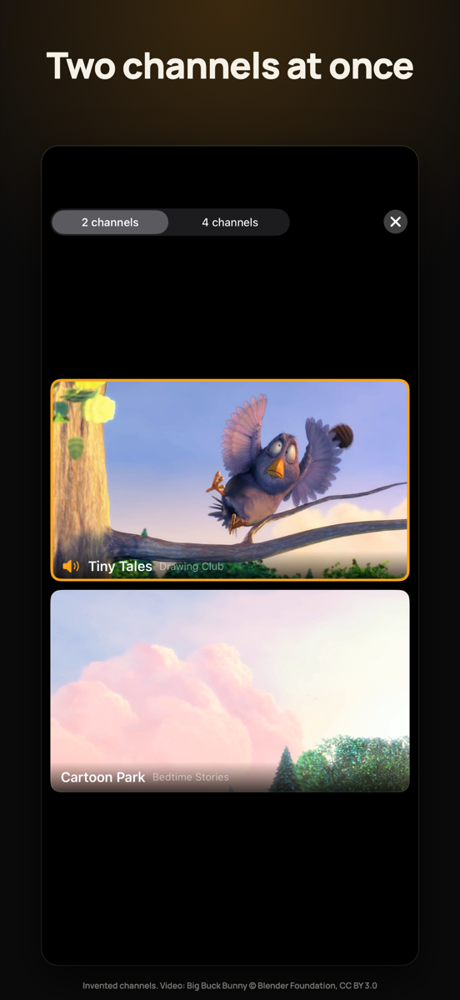
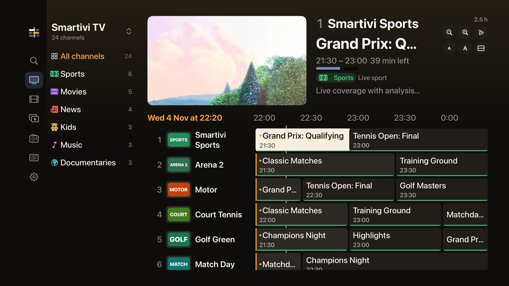
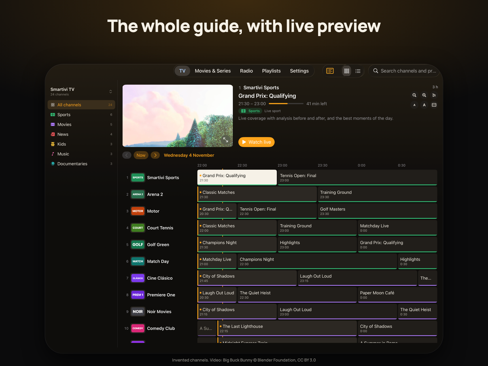
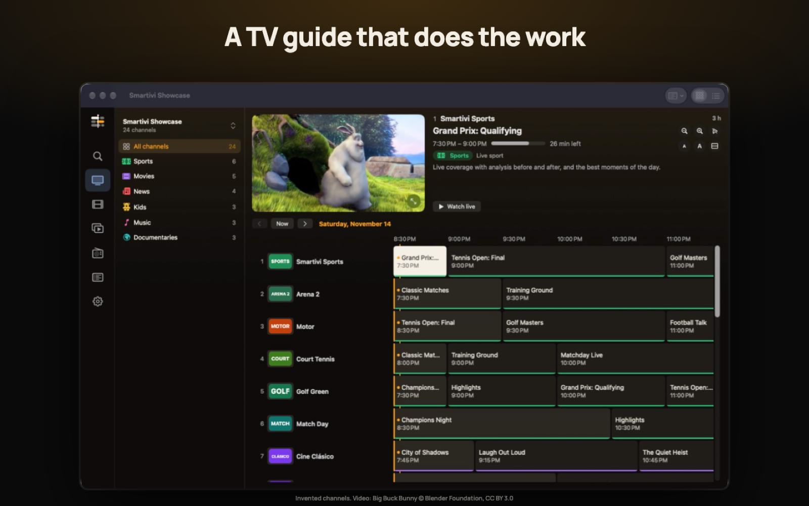

  

<h1 align="center">Smartivi</h1>

  <b>The IPTV player for every screen.</b> 
  A TV guide you can just ask, catch-up, multiview, movies and series. 
  iPhone, iPad, Mac and Apple TV first. Android, Google TV and smart TVs next.

  <a href="https://smartivi.app"><b>Website</b></a> ·
  <a href="https://smartivi.app/#demo">Try the Apple TV app in your browser</a> ·
  <a href="CHANGELOG.md">Changelog</a> ·
  <a href="ROADMAP.md">Roadmap</a> ·
  <a href="https://smartivi.app/help/">Help</a>

<i>Coming soon to the App Store.</i>

> [!IMPORTANT]
> **Smartivi doesn't include channels.** It's a player: bring the M3U playlist or Xtream Codes login from your TV provider, or start with free, legal TV and radio.

## A guide that does the work

- **Ask it what to watch.** Type it or say it (“a scary one tomorrow”, “documentaries now”) and Smartivi shows you what's on your channels. Simple sentences work on every device; with Apple Intelligence it understands freer ones, using the model on your own device.
- **The guide matches itself.** Every channel is linked to its guide even when the name is full of prefixes and qualities, like “UK| NEWS 24 FHD”, or repeated in five versions. No matching by hand.
- **No channel left without a guide.** When your provider leaves channels without a guide, Smartivi finds a public guide from their country and fills them in, shifting the times for West Coast feeds. Your own guide always comes first.
- **Missing logos, found.** Looked up by the channel's name and kept on your device: no grey boxes when your provider's server goes down.
- **Categories by kind.** Playlists with 150 groups like “|ES| SPORTS 1 FHD” become Sports, Movies, Series, News, Kids… per country.
- **It tells you what's wrong.** When a channel won't play, it says in plain words whether it's the provider, your account or the network, and what to try.

## Everything you'd expect, done well

| | |
|---|---|
| 📺 **A real TV guide** | Full grid with live preview, a line for “now”, the whole week ahead, and Tonight's best: the top-rated movies and series on your channels tonight |
| ⏪ **Catch-up, pause and rewind** | Watch past programmes if your provider keeps them, start over what's on, and pause live TV |
| 🔔 **Reminders that switch for you** | A heads-up before a programme, or Smartivi changes to the channel by itself |
| ⚽ **Follow your teams** | Their matches found in your guide for the week, with a reminder before kick-off |
| 🔲 **Multiview** | Two or four channels at once |
| 🎬 **Movies and series** | Your provider's catalog with categories, My list, history and continue watching, with subtitles from OpenSubtitles |
| ▶️ **Plays almost anything** | Apple's engine for HLS, 4K and HDR, and a second one for MPEG-TS and other formats; reconnects if a stream drops |
| 📱 **Your iPhone as the remote** | Pick a channel on your phone and it plays on the Apple TV or Mac |
| ☁️ **Synced with iCloud** | Add a playlist once and it's on all your devices; on Apple TV, add it by scanning a QR code |
| 🎙️ **Siri, Spotlight and widgets** | Plus the Dynamic Island, Handoff, AirPlay, Picture in Picture and Control Center |
| 📻 **Radio from around the world** | The most popular stations in your country, from open, legal directories. Free |
| 🔒 **Make it yours** | Favorites, rename, reorder and hide, only the countries you want, themes, and a PIN for what the kids shouldn't see |

## Screenshots

  
  
  

  

  
  

The channels in the screenshots and the demo are invented.

## Devices and languages

| iPhone and iPad | Mac | Apple TV |
|---|---|---|
| iOS 17 or later | macOS 14 or later | tvOS 18 or later |

English, Spanish, Brazilian and European Portuguese, French, German, Italian and Turkish, with help for every feature in each of them.

## Plans

- **Smartivi Basic: free, no ads.** Free, legal TV and radio, every channel of your playlist with now and next, the guide for the next few hours, favorites, search with a sentence, your iPhone as the remote and parental controls.
- **Smartivi Premium** adds the full guide, channels without a guide filled in, movies and series, catch-up, reminders, your teams, multiview, sync, Picture in Picture and every theme. **€2.99 a month, €14.99 a year with 7 days free, or €29.99 once** (launch price). One purchase covers all your Apple devices, with no device limit; yearly and lifetime are shared with your family. The App Store shows the price in your currency.

## Questions

<b>Does Smartivi include channels?</b>

No. Smartivi is a player: you add the playlist from your TV provider. It also includes free public TV channels and radio stations from open, legal directories.

<b>What do I need to use it?</b>

A playlist link (M3U or M3U8) or the login for an Xtream Codes account, from your provider. Without one you can still watch the free channels and listen to radio.

<b>Does it play 4K and HDR?</b>

Yes, with Apple's video engine, which handles HDR10, HLG and Dolby Vision on screens that support them.

<b>Can I watch on several devices at once?</b>

Smartivi has no device limit. How many channels can play at the same time depends on your provider's account.

<b>Is there an Android version?</b>

Apple devices come first. Android and Google TV are planned next, then smart TVs. See the [roadmap](ROADMAP.md).

## Built in the open

New versions every few days. Every change is in the [changelog](CHANGELOG.md), and what we're weighing next is in the [roadmap](ROADMAP.md). Vote for what comes next in the app (Settings → Help and feedback), or start a thread in [Discussions](../../discussions). Most changes started as a message from someone who uses Smartivi.

## Help and support

- [Help center](https://smartivi.app/help/), also in the app under Settings → Help and feedback
- [support@smartivi.app](mailto:support@smartivi.app)
- [X](https://x.com/smartiviapp) · [Instagram](https://www.instagram.com/smartiviapp/) · [TikTok](https://www.tiktok.com/@smartiviapp) · [Reddit](https://www.reddit.com/user/smartiviapp/)

## About this repository

This repository holds Smartivi's public information: what it does, every change and what's next. The app isn't open source, so there's no code here.

Please don't post playlists, channel links or account details in Discussions: they'll be removed.

© 2026 Smartivi. Apple TV, iPhone, iPad and Mac are trademarks of Apple Inc.
